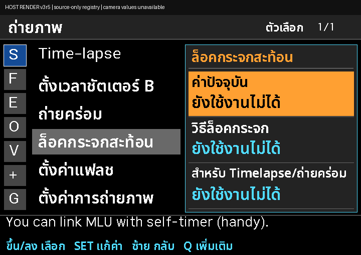
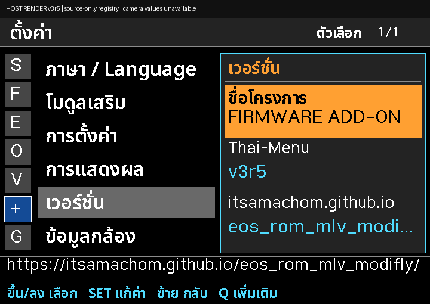

# FIRMWARE ADD-ON · Thai-Menu v3r5

เมนู **ภาษาไทย–อังกฤษสำหรับ Canon EOS 600D / Rebel T3i / Kiss X5** บน **Canon firmware 1.0.2** ต่อยอดจาก Magic Lantern โดยโครงการอิสระนี้

*Thai / English Magic Lantern add-on for Canon EOS 600D. Downloads, installation tutorial and illustrated Thai user manual.*

**[เข้าเว็บไซต์โครงการ](https://itsamachom.github.io/eos_rom_mlv_modifly/) · [เลือกไฟล์ดาวน์โหลด](https://itsamachom.github.io/eos_rom_mlv_modifly/download.html) · [คู่มือภาษาไทยพร้อมภาพ](https://itsamachom.github.io/eos_rom_mlv_modifly/manual-th.html) · [วิดีโอสอนติดตั้ง](https://itsamachom.github.io/eos_rom_mlv_modifly/videos.html)**

## เริ่มต้นตรงนี้

| สิ่งที่ต้องการ | ไปที่ไหน |
| --- | --- |
| ยังไม่เคยติดตั้ง Magic Lantern | [วิธีติดตั้งครั้งแรก](INSTALL_TH.md#ติดตั้งครั้งแรก) และชุด **FIRST-INSTALL** ด้านล่าง |
| มี Magic Lantern ใช้งานอยู่แล้ว | [วิธีอัปเดต](INSTALL_TH.md#อัปเดตกล้องและการ์ดที่มี-ml-แล้ว) และชุด **UPDATE** |
| เรียนรู้เมนูและการตั้งค่า | [คู่มือ 44 เมนู / 116 ตัวเลือกย่อย](https://itsamachom.github.io/eos_rom_mlv_modifly/manual-th.html) · [PDF พร้อมภาพ 42 หน้า](https://itsamachom.github.io/eos_rom_mlv_modifly/manual/Thai-Menu-v3r5-Manual-TH.pdf?edition=illustrated-1) |
| ดูวิธีติดตั้ง | [วิดีโอติดตั้งบน YouTube](https://www.youtube.com/watch?v=Ii1Uv8L9Nf8) · [หน้ารวมวิดีโอ](https://itsamachom.github.io/eos_rom_mlv_modifly/videos.html) |
| ศึกษาหรือพัฒนาโค้ด | [โฟลเดอร์ firmware](firmware/) · [แนวทางมีส่วนร่วม](CONTRIBUTING.md) · [ซอร์สตรงกับรุ่นเผยแพร่](DOWNLOAD.md) |
| พบปัญหาหรือเสนอปรับเมนู | [แจ้งปัญหา](https://github.com/itsamachom/eos_rom_mlv_modifly/issues/new/choose) พร้อมรุ่นกล้อง Canon firmware และรุ่น Thai-Menu |

## ดาวน์โหลด v3r5 — แยกไฟล์ลงกล้องจากซอร์ส

**ยังไม่มี Magic Lantern ก็ติดตั้งด้วยชุด FIRST-INSTALL ได้** ไม่ต้องติดตั้งจากแพ็กอื่นก่อน แต่ต้องตรวจรุ่นกล้อง/Canon firmware และอ่าน [คู่มือติดตั้ง](INSTALL_TH.md) ให้ครบ

| ไฟล์ | สำหรับใคร | ดาวน์โหลด |
| --- | --- | --- |
| **FIRST-INSTALL** | กล้องที่ยังไม่มี Magic Lantern — รวมตัวติดตั้งเดิม `ML-SETUP.FIR`, `autoexec.bin` และ `ML/` | [ZIP · 2.13 MB](https://raw.githubusercontent.com/itsamachom/eos_rom_mlv_modifly/main/downloads/v3r5/first_install/600D-102-Thai-Menu-v3r5-FIRST-INSTALL-doc1.zip) |
| **UPDATE** | กล้องและการ์ดที่ใช้ Magic Lantern อยู่แล้ว — ไม่มี FIR และไม่เรียก Firmware Update ซ้ำเพื่ออัปเดตเมนู | [ZIP · 2.07 MB](https://raw.githubusercontent.com/itsamachom/eos_rom_mlv_modifly/main/downloads/v3r5/camera/600D-102-Thai-Menu-v3r5-UPDATE-doc1.zip) |
| **SOURCE CODE** | ซอร์สสำหรับศึกษา/พัฒนา **ไม่ใช่ไฟล์ติดตั้งลงกล้อง** | [ZIP · 27.32 MB](https://raw.githubusercontent.com/itsamachom/eos_rom_mlv_modifly/main/downloads/v3r5/source/600D-PHOTO-UI-v3r5-source-doc1.zip) |

[รายละเอียดไฟล์และ SHA256](DOWNLOAD.md) · [ติดตั้งภาษาไทย](INSTALL_TH.md) · [English installation](INSTALL_EN.md) · [รายละเอียดรุ่น v3r5](PHOTO_UI_V3R5.md) · [Tag v3r5](https://github.com/itsamachom/eos_rom_mlv_modifly/tree/v3r5)

> **Public Experimental — ไม่ใช่ Stable**: มีผล ARM build และ host checks แต่ยังไม่ได้ยืนยันบิลด์นี้บนกล้องจริง/QEMU หรือการติดตั้งครั้งแรกบนฮาร์ดแวร์ การรวมตัวติดตั้งเดิมไม่ใช่หลักฐานว่าทดสอบติดตั้งผ่านแล้ว ใช้เฉพาะรุ่น/Canon firmware ที่ระบุ

## มีอะไรในโครงการนี้

- Photo UI ภาษาไทยและอังกฤษ แยก 7 หมวด **S / F / E / O / V / + / G** พร้อมเลื่อนข้ามหมวดได้
- หน้าเวอร์ชัน **FIRMWARE ADD-ON / Thai-Menu v3r5** และข้อมูลรุ่นกล้อง Canon firmware กับตัวนับชัตเตอร์/การทำงาน Live View
- คู่มือภาษาไทยแบบตาราง ภาพย่อคลิกขยายได้ ครอบคลุม 44 รายการและตัวเลือกย่อย 116 รายการ
- แยกชุดติดตั้งครั้งแรก ชุดอัปเดต และซอร์สโค้ด พร้อมคู่มือและ checksum
- [วิธีเปิดเกม Arkanoid / Pong / Sokoban](GAMES_TH.md) ด้วยโมดูลที่ตรงกับแพ็ก

ภาพข้างต้นสร้างจากตัววาดเมนูและฟอนต์ในโค้ด **ไม่ใช่ภาพจับจากกล้องจริง** ค่าที่ต้องอ่านจากกล้องใช้สถานะยังไม่พร้อมใช้งาน และสีเป็นพาเลตจำลอง [ดูแกลเลอรีภาพทั้งหมด](https://itsamachom.github.io/eos_rom_mlv_modifly/menu-previews/v3r5/)

## ซอร์ส เครดิต และใบอนุญาต

ต้นทางคือ [Magic Lantern](https://www.magiclantern.fm/) และ [reticulatedpines/magiclantern_simplified](https://github.com/reticulatedpines/magiclantern_simplified) โครงการนี้เป็นงานต่อยอดอิสระ **ไม่ได้รับการรับรองจาก Canon หรือทีม Magic Lantern** และมี [Codex/LLM ช่วยพัฒนา](AI_ASSISTANCE.md)

- [LICENSE](LICENSE) เป็น **GNU GPL version 2** ของโครงการ โดยสิทธิ์อัปเกรดเป็นรุ่นถัดไปให้ยึดประกาศในแต่ละไฟล์ ไม่ลบหรือเปลี่ยนเครดิตต้นทาง
- ส่วนประกอบอื่นยังใช้ใบอนุญาตเดิมของตน เช่น Lua/MIT, TinyCC/LGPL และ Noto Sans Thai/OFL ดู [THIRD_PARTY_NOTICES.md](THIRD_PARTY_NOTICES.md)
- ยังมี [ข้อค้าง corresponding source ของ inherited dietlibc](release/v3r2/PROVENANCE.md) การมีป้าย GPL หรือไฟล์ Source ZIP ไม่ได้ยืนยันว่าตรวจเงื่อนไขการแจกไบนารีครบทุกส่วนแล้ว
- [ประวัติรุ่นเก่า](ARCHIVE.md) ยังอยู่ใน Git; tag รุ่นเดิมไม่ถูกเขียนทับ

## ผู้พัฒนาและติดตามงาน

[เว็บไซต์ FIRMWARE ADD-ON](https://itsamachom.github.io/eos_rom_mlv_modifly/) · [YouTube Online2easy](https://www.youtube.com/@Online2easy) · [Facebook Online2easy](https://www.facebook.com/online2easy) · [Online2hobby Blog](https://online2hobby.blogspot.com/)

ถ้าโครงการมีประโยชน์ กด **Star** เพื่อเก็บไว้ และเลือก **Watch → Custom → Releases** เพื่อติดตามเมื่อมี GitHub Release จริง การอัปเดตเว็บหรือ push โค้ดเพียงอย่างเดียวไม่ใช่การออกรุ่นเฟิร์มแวร์ใหม่

[วิธีมีส่วนร่วม](CONTRIBUTING.md) · [แนวทางข้อมูลหน้า GitHub และการประชาสัมพันธ์](WEBSITE_AND_OUTREACH_TH.md)
