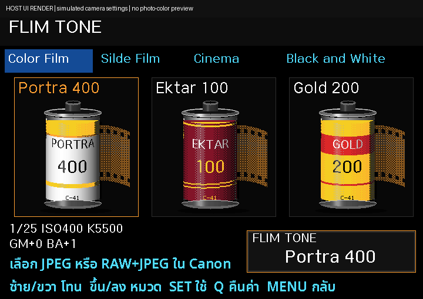
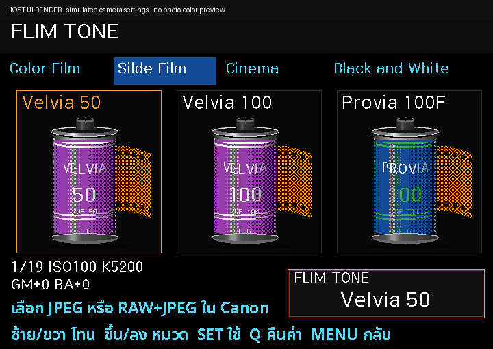
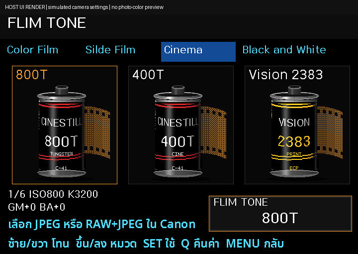
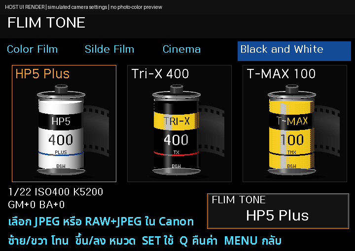
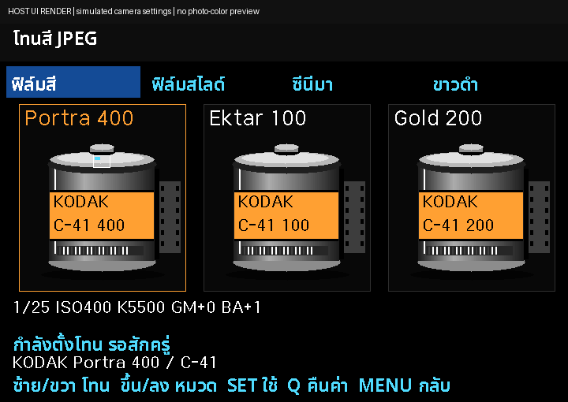

# Thai-Menu v3r6-tone5 — โทนสี JPEG (รุ่นทดสอบ)

เพิ่มเมนู **S → FLIM TONE** เป็นรายการแรกของหมวดถ่ายภาพ เลือกจากภาพม้วนฟิล์มใน 4 หมวด รวม 72 รายการตามชื่อและค่า ISO/Picture Style/WB ของต้นฉบับ (หลายรายการใช้ค่าซ้ำกัน) แล้วให้ Canon สร้าง JPEG ตามปกติ

**นี่คือ branch ทดสอบ ยังไม่ได้ลองถ่ายบนกล้องจริง ไม่ใช่รุ่น Stable** รุ่นหลัก **v3r5** และคู่มือเดิมยังอยู่ที่ [หน้าแรก main](https://github.com/itsamachom/eos_rom_mlv_modifly) และ [เว็บไซต์](https://itsamachom.github.io/eos_rom_mlv_modifly/)

[วิธีใช้และข้อจำกัด](PHOTO_UI_V3R6-TONE5.md) · [สูตรและแหล่งที่มา](research/jpeg-tones/README.md) · [ซอร์สที่แก้](firmware/src/photo-tone-600d.h)

## ดาวน์โหลดสำหรับทดลอง

สำหรับกล้อง/การ์ดที่ใช้ Magic Lantern ได้อยู่แล้ว เลือก UPDATE และสำรองชุดเดิมทั้งชุดก่อนทดลอง ใช้เฉพาะ **Canon EOS 600D / Canon firmware 1.0.2** อ่าน [INSTALL_TH.md](INSTALL_TH.md) ก่อนคัดลอกไฟล์ ไม่เรียก Firmware Update ซ้ำเพื่ออัปเดตเมนู

- [UPDATE ZIP](https://raw.githubusercontent.com/itsamachom/eos_rom_mlv_modifly/v3r6-tone5/downloads/v3r6-tone5/camera/600D-102-Thai-Menu-v3r6-tone5-UPDATE.zip)
- [ซอร์สโค้ดตรงกับชุดทดสอบ](https://raw.githubusercontent.com/itsamachom/eos_rom_mlv_modifly/v3r6-tone5/deliveries/photo-ui-v3r6-tone5-full/600D-PHOTO-UI-v3r6-tone5-source.zip)
- [SHA256](downloads/v3r6-tone5/SHA256SUMS)

## หน้าตาเมนู

ภาพจำลองจากตัววาดเมนูจริงบน host พร้อมฟอนต์ที่ใช้ในกล้อง ค่ากล้องเป็น fixture สีเป็นพาเลตจำลอง **ไม่ใช่ภาพตัวอย่างผลสี JPEG** คลิกภาพเพื่อดูเต็ม

| ฟิล์มสี | ฟิล์มสไลด์ |
| --- | --- |
|  |  |
| ซีนีมา | ขาวดำ |
|  |  |

แอนิเมชันแสดงลักษณะตัวบอกขั้นตอนการตั้งค่า ไม่ใช่เวลาที่วัดบนกล้องจริง ไม่มีการแปลงไฟล์หลังถ่ายเพิ่มจากฟีเจอร์นี้ และไม่มีการหน่วงเวลาเพื่อเล่นแอนิเมชัน

## ใช้แบบย่อ

1. เลือก P / Tv / Av / M และตั้งคุณภาพภาพใน Canon เป็น JPEG หรือ RAW+JPEG
2. S → FLIM TONE → SET; ขึ้น/ลงเปลี่ยนหมวด ซ้าย/ขวาเปลี่ยนโทน
3. SET แล้ว SET ยืนยัน รอชื่อ **โทนที่ใช้อยู่** ก่อนถ่าย
4. Q แล้ว SET คืนค่าเดิมที่สำรองใน RAM ก่อนปิดกล้อง การเปลี่ยนโทนแก้ Picture Style/WB/ISO ของ Canon จริง ซึ่งอาจคงอยู่หลังรีสตาร์ต ข้อมูลสำรองไม่ข้ามการปิดกล้อง

ตั้ง ISO ตามวิธีแปลงของต้นฉบับ ไม่สั่งเปลี่ยนชัตเตอร์ รูรับแสง หรือคุณภาพไฟล์ ไม่ใช้ LUT/ล้าง RAW และไม่อ้างว่าได้ 72 ลุคเต็มของ M-Film

## เครดิตและผลตรวจ

สูตร native preview: HNGSeries/M-Film 0.2.1 (GPL-2.0) · [หลักฐาน](research/jpeg-tones/UPSTREAM_ORIGINAL_CATALOG.json) · [GPL ต้นทาง](research/jpeg-tones/M-FILM-GPL-2.0.txt)

UI และ adapter เขียนสำหรับโครงการนี้ มี Codex/LLM ช่วยพัฒนา ผ่าน host tests และ ARM build ยังต้องยืนยันการบูต/คุณภาพ JPEG/ความเร็วบน 600D จริง ข้อค้างซอร์ส inherited dietlibc ยังอยู่ตาม [THIRD_PARTY_NOTICES.md](THIRD_PARTY_NOTICES.md)

ผู้พัฒนา: [YouTube Online2easy](https://www.youtube.com/@Online2easy) · [Facebook Online2easy](https://www.facebook.com/online2easy) · [Online2hobby Blog](https://online2hobby.blogspot.com/)

## ตัวอย่างออกแบบภาพฟิล์ม — ยังไม่ใส่ในกล้อง

[กล่องมุมเฉียง](design/film-concepts/v3r6-tone3/angled-box.png) · [ด้านหน้ากล่อง](design/film-concepts/v3r6-tone3/front-box.png) · [กลักฟิล์มเดี่ยว](design/film-concepts/v3r6-tone3/canister.png)

ชื่อเมนูทดลอง: **FLIM TONE** · **Color Film** · **Silde Film** · **Cinema** · **Black and White** ตามการสะกดที่ขอ

## ภาพกลักทรงสูงแยกตามชื่อฟิล์ม — tone4

ภาพในกล้องเปลี่ยนแล้วเป็นทรงสูง พร้อมสี/ลาย/ชื่อแนวตั้งแยกครบ72รายการ สูตร ISO/WB/Picture Style เดิมไม่เปลี่ยน

[ดูภาพเมนูจากโค้ดจริง](previews/jpeg-tones/tones-th-01.png) · [ดูรายการและภาพครบ72](research/film-labels/GALLERY_TH.md) · [ดูภาพร่างความละเอียดสูง](design/film-concepts/v3r6-tone4/tall-stock-concepts.png)

ข้อมูลฉลากอ้างอิง M-Film GPL-2.0-only และแปลงเป็นสีที่กล้องรองรับ ยังไม่ได้ตรวจภาพสินค้าจริงครบทุกชื่อเพราะเว็บค้นรูปถูกบล็อก ภาพX-Pro/ฟิล์มพิมพ์ภาพยนตร์เป็นภาพตีความ รุ่นหลักบนเว็บและคู่มือยังคงv3r5

## tone5: ฉลากโค้งและกรอบโทนที่ใช้อยู่

ใช้การพันฉลากบนทรงกระบอก ไล่เงา/แสงสะท้อน และฟอนต์RBFขนาดใหญ่ขึ้น สีฐาน/ชื่อและสูตรเดิมไม่เปลี่ยน กรอบมุมล่างขวาแสดงโทนที่ใช้อยู่จริงโดยคงชื่อเดิมระหว่างเลื่อนดูตัวอื่น

[ภาพใช้โทนสำเร็จ](previews/jpeg-tones/tone-active-th.png) · [ภาพระหว่างbrowse](previews/jpeg-tones/tone-browsing-th.png) · [วิธีวาดที่ศึกษาจากต้นทาง](research/film-labels/CYLINDER_RENDERING.md)

ภาพเป็นhost captureจากโค้ดจริง ไม่ใช่ภาพจากกล้องหรือภาพตัวอย่างสีJPEG ยังต้องยืนยันความลื่นและภาพบน600Dจริง รุ่นหลัก/คู่มือบนเว็บยังเป็นv3r5
