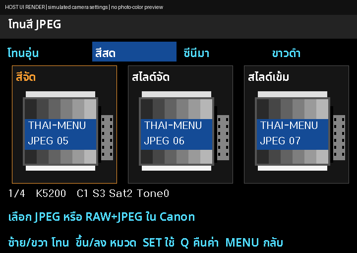
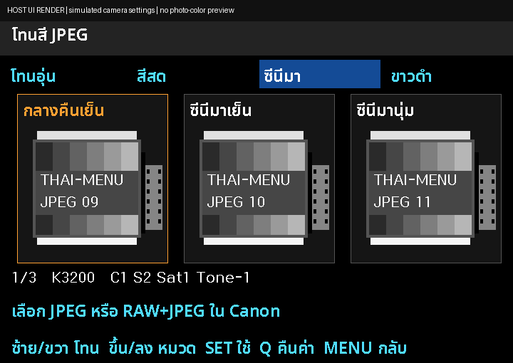
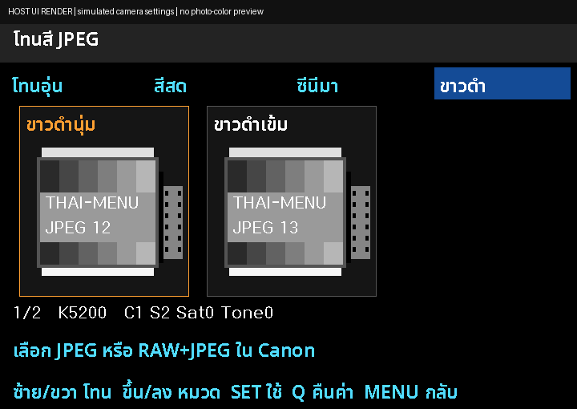

# Thai-Menu v3r6-tone1 — โทนสี JPEG (รุ่นทดสอบ)

เพิ่มเมนู **S → โทนสี JPEG** เป็นรายการแรกของหมวดถ่ายภาพ เลือกจากภาพม้วนฟิล์มใน 4 หมวด รวม 13 สูตร Picture Style/WB ที่แตกต่างกันจริง แล้วให้ Canon สร้าง JPEG ตามปกติ

**นี่คือ branch ทดสอบ ยังไม่ได้ลองถ่ายบนกล้องจริง ไม่ใช่รุ่น Stable** รุ่นเผยแพร่เดิมยังอยู่ที่ [หน้าแรก main](https://github.com/itsamachom/eos_rom_mlv_modifly) และ [เว็บไซต์](https://itsamachom.github.io/eos_rom_mlv_modifly/)

[วิธีใช้และข้อจำกัด](PHOTO_UI_V3R6-TONE1.md) · [สูตรและแหล่งที่มา](research/jpeg-tones/README.md) · [ซอร์สที่แก้](firmware/src/photo-tone-600d.h)

## ดาวน์โหลดสำหรับทดลอง

สำหรับกล้อง/การ์ดที่ใช้ Magic Lantern ได้อยู่แล้ว เลือก UPDATE และสำรองชุดเดิมทั้งชุดก่อนทดลอง ใช้เฉพาะ **Canon EOS 600D / Canon firmware 1.0.2** อ่าน [INSTALL_TH.md](INSTALL_TH.md) ก่อนคัดลอกไฟล์ ไม่เรียก Firmware Update ซ้ำเพื่ออัปเดตเมนู

- [UPDATE ZIP](https://raw.githubusercontent.com/itsamachom/eos_rom_mlv_modifly/feature/jpeg-tone-picker/downloads/v3r6-tone1/camera/600D-102-Thai-Menu-v3r6-tone1-UPDATE.zip)
- [ซอร์สโค้ดตรงกับชุดทดสอบ](https://raw.githubusercontent.com/itsamachom/eos_rom_mlv_modifly/feature/jpeg-tone-picker/deliveries/photo-ui-v3r6-tone1-full/600D-PHOTO-UI-v3r6-tone1-source.zip)
- [SHA256](downloads/v3r6-tone1/SHA256SUMS)

## หน้าตาเมนู

ภาพจำลองจากตัววาดเมนูจริงบน host พร้อมฟอนต์ที่ใช้ในกล้อง ค่ากล้องเป็น fixture สีเป็นพาเลตจำลอง **ไม่ใช่ภาพตัวอย่างผลสี JPEG** คลิกภาพเพื่อดูเต็ม

| โทนอุ่น | สีสด |
| --- | --- |
|  |  |
| ซีนีมา | ขาวดำ |
|  |  |

แอนิเมชันแสดงลักษณะตัวบอกขั้นตอนการตั้งค่า ไม่ใช่เวลาที่วัดบนกล้องจริง ไม่มีการแปลงไฟล์หลังถ่ายเพิ่มจากฟีเจอร์นี้ และไม่มีการหน่วงเวลาเพื่อเล่นแอนิเมชัน

## ใช้แบบย่อ

1. เลือก P / Tv / Av / M และตั้งคุณภาพภาพใน Canon เป็น JPEG หรือ RAW+JPEG
2. S → โทนสี JPEG → SET; ขึ้น/ลงเปลี่ยนหมวด ซ้าย/ขวาเปลี่ยนโทน
3. SET แล้ว SET ยืนยัน รอชื่อ **โทนที่ใช้อยู่** ก่อนถ่าย
4. Q แล้ว SET คืนค่าเดิมที่สำรองใน RAM ก่อนปิดกล้อง การเปลี่ยนโทนแก้ Picture Style/WB ของ Canon จริง ซึ่งอาจคงอยู่หลังรีสตาร์ต ข้อมูลสำรองไม่ข้ามการปิดกล้อง

ไม่สั่งเปลี่ยน ISO ชัตเตอร์ รูรับแสง หรือคุณภาพไฟล์ ไม่ใช้ LUT/ล้าง RAW และไม่อ้างว่าได้ 72 ลุคเต็มของ M-Film

## เครดิตและผลตรวจ

สูตร native preview: HNGSeries/M-Film 0.2.1 (GPL-2.0) · [หลักฐาน](research/jpeg-tones/UPSTREAM_NATIVE_RECIPES.json) · [GPL ต้นทาง](research/jpeg-tones/M-FILM-GPL-2.0.txt)

UI และ adapter เขียนสำหรับโครงการนี้ มี Codex/LLM ช่วยพัฒนา ผ่าน host tests และ ARM build ยังต้องยืนยันการบูต/คุณภาพ JPEG/ความเร็วบน 600D จริง ข้อค้างซอร์ส inherited dietlibc ยังอยู่ตาม [THIRD_PARTY_NOTICES.md](THIRD_PARTY_NOTICES.md)

ผู้พัฒนา: [YouTube Online2easy](https://www.youtube.com/@Online2easy) · [Facebook Online2easy](https://www.facebook.com/online2easy) · [Online2hobby Blog](https://online2hobby.blogspot.com/)
